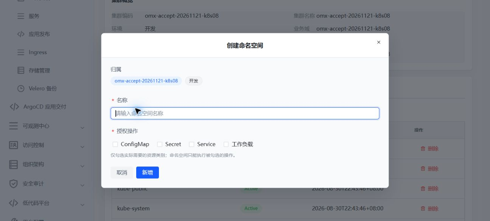

# K8s 实机验收结果

本地 Pantheon Ops 对接 115.190.251.143 现有 K3s。结论：PARTIAL；22 项 PASS、0 项 FAIL、1 项 BLOCKED。原 V1–V8 与旧十包保持开放。

## 环境与边界

- 服务器固定 SSH 指纹，Kubeconfig 只在内存读取。公网 API 使用原 CA 与 tls-server-name=localhost，TLS 验证开启。
- 所有远端写入限定本任务命名空间；没有改动现有业务、K3s、证书、防火墙或 Velero 部署。
- 当前后端 SHA256：`fba00055818a050995ad1fffb7cebec95c761f955ebf62da37c9e41c7667b129`。见 [源文件与构建回执](k8s-final-receipt.json)。
- Claude 修改业务实现；Codex 审查、准备环境、编写验收工具并执行验收。历史失败、CLI 非零退出与未交付结果全部保留。

## 场景矩阵

| ID | 实际场景 | 状态 | 原始证据 |
|---|---|---|---|
| k00 | local Ops readiness before real acceptance | PASS | [k00](k8s/omx-accept-20261121-k8s11/k00-20261121-191741.json) |
| k01 | pinned SSH and CA-verified public API configuration | PASS | [k01](k8s/omx-accept-20261121-k8s11/k01-20261121-191741.json) |
| k02 | local Ops login | PASS | [k02](k8s/omx-accept-20261121-k8s11/k02-20261121-191741.json) |
| k03 | register real cluster and credential redaction | PASS | [k03](k8s/omx-accept-20261121-k8s11/k03-20261121-191741.json) |
| k03b | cluster creation credential metadata consistency | PASS | [k03b](k8s/omx-accept-20261121-k8s11/k03b-20261121-191741.json) |
| k04 | sync real nodes and capacity | PASS | [k04](k8s/omx-accept-20261121-k8s11/k04-20261121-191741.json) |
| k05 | owned namespace creation | PASS | [k05](k8s/omx-accept-20261121-k8s11/k05-20261121-191741.json) |
| k06 | ConfigMap create/read/pagination | PASS | [k06](k8s/omx-accept-20261121-k8s11/k06-20261121-191741.json) |
| k07 | Secret create/read values redacted | PASS | [k07](k8s/omx-accept-20261121-k8s11/k07-20261121-191741.json) |
| k08 | Service CRUD CAS and malformed input | PASS | [k08](k8s/omx-accept-20261121-k8s11/k08-20261121-191741.json) |
| k09 | prepare minimal existing-image Deployment fixture | PASS | [k09](k8s/omx-accept-20261121-k8s11/k09-20261121-191741.json) |
| k10 | real workload scale and restart | PASS | [k10](k8s/omx-accept-20261121-k8s11/k10-20261121-191741.json) |
| k11 | scale-to-zero acceptance | PASS | [k11](k8s/omx-accept-20261121-k8s11/k11-20261121-191741.json) |
| k12 | real Pod logs over WebSocket | PASS | [k12](k8s/omx-accept-20261121-k8s11/k12-20261121-191741.json) |
| k13 | warm-cache credential rotation and restore | PASS | [k13](k8s/omx-accept-20261121-k8s11/k13-20261121-191741.json) |
| k14 | namespace ownership and write protection | PASS | [k14](k8s/omx-accept-20261121-k8s11/k14-20261121-191741.json) |
| k16 | Helm registration CRUD without false deployment status | PASS | [k16](k8s/omx-accept-20261121-k8s11/k16-20261121-191741.json) |
| k17 | real storage discovery and snapshots | PASS | [k17](k8s/omx-accept-20261121-k8s11/k17-20261121-191741.json) |
| k18 | real image release idempotency and rollback | PASS | [k18](k8s/omx-accept-20261121-k8s11/k18-20261121-191741.json) |
| k19 | existing Velero provider and dedicated ConfigMap backup | BLOCKED | [k19](k8s/omx-accept-20261121-k8s11/k19-20261121-191741.json) |
| k20 | non-admin read/write/credential authorization | PASS | [k20](k8s/omx-accept-20261121-k8s11/k20-20261121-191741.json) |
| k15 | owned resources cleanup and independent absence | PASS | [k15](k8s/omx-accept-20261121-k8s11/k15-20261121-191741.json) |
| ku01 | UI-created namespace ownership and selected write permissions | PASS | [ku01](k8s/omx-accept-20261121-k8s08/ku01-20261121-094039.json) |

每项原始 JSON 含身份、前置条件、工具、预期信号、实际 API 调用、耗时及清理链路。k09 是准备 Deployment 测试资源，不代表产品支持创建 Deployment。

## 发现与修复

1. 集群创建凭据元数据不一致及凭据轮换复用旧特权 client：Claude23 修复，真实 API + 缓存负例复验通过。
2. 缩容到 0 被 required 校验误拒，版本冲突返回 500：Claude27 修复，显式 0、正数、missing/null/negative/string 回归及实机复验。
3. 命名空间表单缺归属/授权：Claude26 修复，Claude30 补业务 fallback 翻译；真实 UI 提交、独立集群存在核对和选择授权行为通过。
4. 无 PV/PVC 时空快照插入失败：Claude28 修复空切片与事务，实机同步和 MySQL race 通过。
5. 发布在版本冲突时失去 typed conflict：run10 保留真实失败，后续修复/复验见最终 run 与 Claude31 交付。

## 验证与限制

- K8s 真实 MySQL required race 使用 CGO 和 MinGW；按最新 k8s-race-mysql 回执评估，不能以无 DSN 的跳过测试代替。
- 前端类型、改动文件 lint、正式 build 和 overlay 合同通过；overlay 59/59 零跳过。
- 完整仓库 race 未通过：11 个失败标记、39 个跳过，含多个 600 秒超时和 observability 失败。没有宣布整体门禁通过或修改门禁。
- Velero Pod 独立检查为 Pending；已有 BackupStorageLocation 尚无有效 phase。没有执行备份、恢复或调整其部署。见 [provider 实况](k8s/omx-accept-20261121-k8s09/kd01-20261121-092848.json)。
- Helm 本次仅验登记 CRUD 与 registered 状态；产品没有真实 Chart 安装执行。
- Ingress 只提供快照列表/同步/删除，未执行其快照验收；现有 K3s 的复用验收不能替代全新安装流程。
- 原 V8 的 ServiceAccount 撤销/工作负载轮询、双租户隔离、长耗时前端重试、WebSocket 服务端关闭释放仍未验收。

## UI 与清理

命名空间中文列表、归属和授权表单、真实提交成功已渲染核对；移动、暗色及全键盘场景尚未验收。

最终 run 与 UI followup 的专属命名空间、集群登记、业务域、Helm 记录、发布/存储快照和临时用户/角色均按回执清理。远端命名空间删除后经独立 kubectl 确认缺失。审计日志保留为证据。

Gate Outcomes: live K8s caught credential cache reuse, zero-scale validation, namespace payload/i18n and empty snapshot failures; repeat run caught release CAS error masking | readiness apparatus errors recorded separately from product failures.
